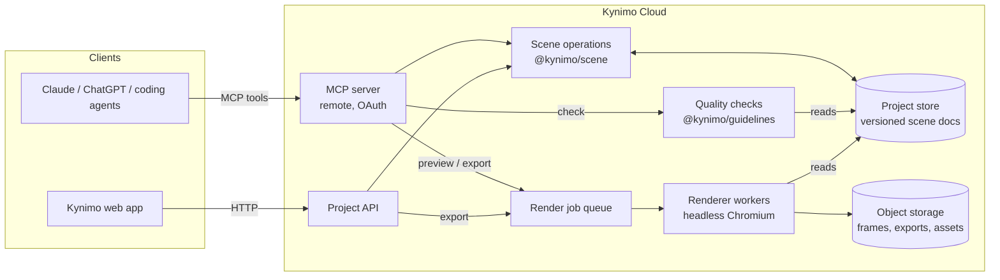

# Kynimo — Architecture

Status: scene format, engine, renderer, capture and the MCP server (M1–M3) are built as described; guidelines, components, separate render workers and the web app are still direction; exports run in-process in the MCP server (ADR-0048). Each section firms up as the feature that needs it is built; decisions land as ADRs in [decisions/](decisions/).

## System overview

Every write — from an agent, the web app or code — goes through the same **scene operations** layer and produces a new document version. Rendering and quality checks only ever read a specific document version.

## The four pillars

Capability target: the 2D core of After Effects, all of it reachable over MCP; the editor stays simple (ADR-0008, [CAPABILITIES.md](CAPABILITIES.md)).

### 1. Scene format — `@kynimo/scene`

- Versioned JSON scene graph: `Project → Composition[] → Layer[]` (shape, text, image, video, solid, null, precomp, adjustment, audio, component instance, shader generator; 3D layers, cameras, lights and models in v1.x; parenting and masks/mattes between layers), each with animatable properties and keyframe tracks, plus a guideline pack reference pinned by version. A scene is a composition placed in the main composition's sequence; precomp layers reference compositions by id, with no cycles. Audio is audio layers; beat markers live on them. See [CAPABILITIES.md](CAPABILITIES.md#document-model).
- Schema-validated (runtime schemas + inferred TS types). `SCENE_FORMAT_VERSION` + migrations for every change.
- **Typed operations** (`addLayer`, `setKeyframes`, …) are the only way to mutate a document. Intent tools such as `animate` and `apply_preset` expand into these operations (`@kynimo/intent`, ADR-0040). They're pure: `(doc, op) → doc'` plus a change record, which gives undo, history and conflict detection for free.
- Time model: integer frames at the composition frame rate; seconds only at the API edge.

### 2. Guidelines — `@kynimo/guidelines`

- **Tokens:** color, typography, spacing, grid, safe areas; motion tokens (durations, springs as damping + response, easing curves, stagger rhythms).
- **Rules:** choreography and quality checks expressed as code over the scene graph + rendered frames, e.g. minimum on-screen time per word, maximum concurrent motions, contrast, safe-area bounds, token-only easing.
- **Output:** a machine-readable quality report (rule id, severity, location in the scene graph, suggested fix) that agents act on.
- Packs are data (versioned), so new styles and custom brand packs don't require code changes. Built so far (ADR-0037): the pack format with fixed token names, four draft packs, token resolution (milliseconds → frames, reference pixels → composition pixels) and a pack's validation against its own rules. The rules engine and report are M5.

### 3. Components — `@kynimo/components`

- Typed props schema + defaults + a deterministic `evaluate(props, frame, style) → layer subtree` function.
- Components read the active guideline, so the same component looks right in every style.
- Built-in library first (kinetic type, lower third, logo reveal, transitions and backgrounds, ADR-0047). **Code authoring** (ADR-0012): agents and users write custom components in TypeScript and shaders in GLSL, submitted over MCP (`define_component`, `define_shader`). Definitions are validated, versioned, content-hashed and stored per project; documents pin them by id + version. Component code runs in a sandbox with no host, filesystem, network, secret, clock or unseeded random access; shaders see only `frame`, resolution and declared uniforms.

### 4. Renderer — `@kynimo/renderer`

- v1: the scene is evaluated per frame and drawn in the browser: CanvasKit (Skia WASM) rasterizes shapes, images and text on the CPU, and our own **WebGL2** compositor runs blend modes, mattes, mask application, effects and shaders (ADR-0013, ADR-0016, ADR-0020); the **same code** runs in the web preview and in headless Chromium workers for frames and exports (ADR-0004). `@kynimo/capture` runs the whole pipeline in the pinned Chromium and returns PNGs with pixel hashes, optionally downscaled or tiled into a contact sheet (ADR-0022, ADR-0026). GPU drawing is required for shaders and, from v1.x, 3D compositing and glTF models.
- Deterministic: bundled and uploaded fonts pinned by hash, with missing glyphs falling back only to bundled Noto Sans (ADR-0019), pre-decoded video, seeded randomness, no wall-clock time.
- Export (ADR-0048): an export session in the capture page draws raw RGBA frames (repeated frames skipped) that are piped to FFmpeg for MP4/WebM/GIF; audio layers are mixed in TypeScript. For now this runs as an in-process job in the MCP server; separate workers come with deploy.

## Agent layer — `apps/mcp`

- Remote MCP server (Streamable HTTP) with OAuth; a local stdio mode for development.
- Tool groups (project, read, precise, intent, code, style, feedback, output) and design principles (batched `apply_ops`, selectors, compact reads, motion summaries, optimistic concurrency) are in [CAPABILITIES.md](CAPABILITIES.md#mcp-surface).
- Every tool: schema-validated input/output, returns the new document version, backward compatible.
- Scripts (ADR-0036): `run_script` runs agent-written TypeScript once in a QuickJS (WebAssembly) sandbox, one worker thread and one fresh instance per script, with no clock, randomness or host access and counted limits. Its output is a batch of operations the host validates and applies like any other: the sandbox records entries (ops and intent calls), the host replays them with `@kynimo/intent` (ADR-0041).
- Reliability contracts (ADR-0018): a capability manifest generated from code, idempotency keys and outcome lookup on writes, declared limits and a content-addressed cache on renders, cancellable jobs, fidelity reports on every import and export.

## Web app — `apps/web`

Player first, editor second (ADR-0035).

- **Player and review (M8):** sign in, project list, a share page that plays the document on the shared renderer with timeline scrubbing and shows agent edits live, and frame-pinned comments the agent reads over MCP. Where an MCP client renders UI, the same player appears in the chat.
- **Editor (M9, during the private beta):** layer list, inspector, basic keyframe editing and the timing-finish view (ADR-0018), all on the same scene operations. It starts simple and grows toward an After Effects-like workflow.

## Agent evaluation — the brief suite

A fixed set of briefs run by a real model against the MCP server, with a report per run: completion, tool calls, rejected calls, tokens, contact sheets (PRODUCT.md, "How we know it works"; ADR-0035). It drives the server only through MCP, like any client, runs on demand rather than in CI (it needs a model key and isn't deterministic), and never touches evaluation or render paths. It lives in `apps/evals`, created with the M4 item.

## Package map (target)

| Path                  | Package                                                                                                                                         | Created in |
| --------------------- | ----------------------------------------------------------------------------------------------------------------------------------------------- | ---------- |
| `packages/scene`      | `@kynimo/scene` — schema, types, operations, migrations                                                                                         | M1         |
| `packages/engine`     | `@kynimo/engine` — timeline, interpolation, springs, behaviors, text animators, shape operators                                                 | M1         |
| `packages/renderer`   | `@kynimo/renderer` — frame drawing, built-in shaders                                                                                            | M2         |
| `packages/capture`    | `@kynimo/capture` — headless capture: document + frames → PNG in the pinned Chromium (ADR-0022)                                                 | M2         |
| `apps/mcp`            | `@kynimo/mcp` — MCP server: tools over scene operations, project stores incl. Postgres, render tools via capture (ADR-0024, ADR-0026, ADR-0029) | M3         |
| `packages/guidelines` | `@kynimo/guidelines` — pack format, built-in packs, token resolution (ADR-0037); quality rules in M5                                            | M4         |
| `packages/intent`     | `@kynimo/intent` — pure expansions of intent tools (animate, stagger, retime, presets) into operations over guideline tokens (ADR-0040)         | M4         |
| `packages/script`     | `@kynimo/script` — sandbox runner and SDK for `run_script` (ADR-0036, ADR-0041)                                                                 | M4         |
| `packages/svg`        | `@kynimo/svg` — pure SVG-to-shape-layer converter with a fidelity report, behind `import_svg`                                                   | M4         |
| `packages/components` | `@kynimo/components` — component model (typed props, style-aware host over the engine hook, ADR-0012), built-in library                         | M6         |
| `apps/worker`         | render/export workers (exports run in-process in `apps/mcp` until deploy, ADR-0048)                                                             | M7         |
| `apps/evals`          | brief suite: briefs, runner, reports (ADR-0035)                                                                                                 | M4         |
| `apps/web`            | web app (Next.js on Vercel, ADR-0007): player and share page, then the editor — placeholder exists                                              | M8 / M9    |

## Invariants

See [AGENTS.md](../AGENTS.md#architecture-invariants-reviewers-block-on-these): scene graph is the single source of truth · deterministic rendering · versioned schema with migrations · typed, backward-compatible MCP contracts · sandboxed custom code (components and shaders) · quality enforced in code.

## Open questions (settled in the feature that needs them)

| Question                                                                                                           | Decide in |
| ------------------------------------------------------------------------------------------------------------------ | --------- |
| ~~Runtime schema library~~ → Zod 4 (ADR-0009)                                                                      | done      |
| ~~WebGL2 stack for v1~~ → Skia CPU raster + own WebGL2 compositor (ADR-0016)                                       | done      |
| Sandbox for per-frame component code (QuickJS is chosen for scripts, ADR-0036); shader validation rules (ADR-0012) | M6        |
| How documents refer to tokens (ADR-0037)                                                                           | M5        |
| Hosting for API/MCP and workers                                                                                    | M3 / M7   |
| ~~Database for project store~~ → Postgres on `pg`, host-agnostic (ADR-0029)                                        | done      |
| ~~Auth / OAuth provider~~ → external issuer, Kynimo as resource server; WorkOS AuthKit first (ADR-0033)            | done      |
| ~~Job queue~~ → in-process now, Postgres-backed with workers at deploy (ADR-0048)                                  | M7        |
| MCP UI in chat clients: which clients render it, and how the player is delivered (ADR-0035)                        | M8        |
| ~~Object storage for assets~~ → S3-compatible, Cloudflare R2 first, content-addressed (ADR-0031); CDN for previews | M7        |
| ~~Web framework~~ → Next.js on Vercel (ADR-0007)                                                                   | done      |
