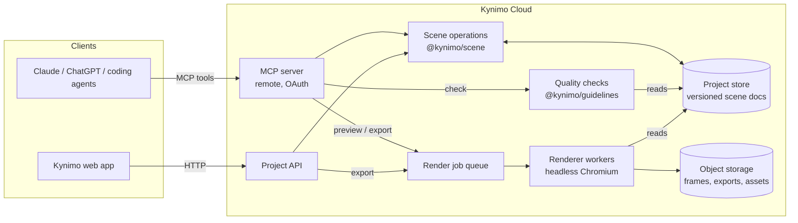

# Kynimo — Architecture

Status: **initial direction**. Each section firms up as the feature that needs it is built; decisions land as ADRs in [decisions/](decisions/).

## System overview

Every write — from an agent, the web app or code — goes through the same **scene operations** layer and produces a new document version. Rendering and quality checks only ever read a specific document version.

## The four pillars

### 1. Scene format — `@kynimo/scene`

- Versioned JSON scene graph: `Project → Composition → Scene[] → Layer[]` (shape, text, image, video, group, component instance), each with animatable properties and keyframe tracks, plus a style (guideline pack) reference and audio track with beat markers.
- Schema-validated (runtime schemas + inferred TS types). `SCENE_FORMAT_VERSION` + migrations for every change.
- **Typed operations** (`addLayer`, `setKeyframes`, `applyPreset`, `retimeScene`, …) are the only way to mutate a document. They're pure: `(doc, op) → doc'` plus a change record, which gives undo, history and conflict detection for free.
- Time model: integer frames at the composition frame rate; seconds only at the API edge.

### 2. Guidelines — `@kynimo/guidelines`

- **Tokens:** color, typography, spacing, grid, safe areas; motion tokens (durations, springs as damping + response, easing curves, stagger rhythms).
- **Rules:** choreography and quality checks expressed as code over the scene graph + rendered frames, e.g. minimum on-screen time per word, maximum concurrent motions, contrast, safe-area bounds, token-only easing.
- **Output:** a machine-readable quality report (rule id, severity, location in the scene graph, suggested fix) that agents act on.
- Packs are data (versioned), so new styles and custom brand packs don't require code changes.

### 3. Components — `@kynimo/components`

- Typed props schema + defaults + a deterministic `evaluate(props, frame, style) → layer subtree` function.
- Components read the active guideline, so the same component looks right in every style.
- Built-in library first; custom components (user-authored TS) run in a sandbox with no host, filesystem, network or secret access.

### 4. Renderer — `@kynimo/renderer`

- v1: the scene is evaluated per frame and drawn in the browser (Canvas/SVG/DOM); the **same code** runs in the web preview and in headless Chromium workers for frames and exports (ADR-0004).
- Deterministic: fixed fonts and assets, seeded randomness, no wall-clock time.
- Encoding to MP4/WebM/GIF via FFmpeg in workers.

## Agent layer — `apps/mcp`

- Remote MCP server (Streamable HTTP) with OAuth; a local stdio mode for development.
- Tools in three groups:
  - **Intent:** `build_from_brief`, `apply_style`, `add_component`.
  - **Precise:** `create_project`, `add_layer`, `update_props`, `set_keyframes`, `retime_scene`, `get_scene`.
  - **Feedback:** `render_frames` (returns images), `check_quality` (returns the report), `export`, `get_preview_link`.
- Every tool: schema-validated input/output, returns the new document version, backward compatible.

## Web app — `apps/web`

Thin in v1: sign in, project list, preview player with timeline scrubbing, share links. Later: frame-pinned comments that feed back to the agent; a light editor on top of the same scene operations.

## Package map (target)

| Path                  | Package                                                     | Created in       |
| --------------------- | ----------------------------------------------------------- | ---------------- |
| `packages/scene`      | `@kynimo/scene` — schema, types, operations, migrations     | M1 (stub exists) |
| `packages/engine`     | `@kynimo/engine` — timeline, interpolation, easing, springs | M1               |
| `packages/renderer`   | `@kynimo/renderer` — frame drawing + headless capture       | M2               |
| `apps/mcp`            | MCP server                                                  | M3               |
| `packages/guidelines` | `@kynimo/guidelines` — tokens, packs, quality rules         | M4               |
| `packages/components` | `@kynimo/components` — built-in library + SDK               | M5               |
| `apps/worker`         | render/export workers                                       | M6               |
| `apps/web`            | web app                                                     | M7               |

## Invariants

See [CLAUDE.md](../CLAUDE.md#architecture-invariants-the-reviewer-blocks-on-these): scene graph is the single source of truth · deterministic rendering · versioned schema with migrations · typed, backward-compatible MCP contracts · sandboxed custom components · quality enforced in code.

## Open questions (settled in the feature that needs them)

| Question                                           | Decide in |
| -------------------------------------------------- | --------- |
| Runtime schema library (Zod vs Valibot vs TypeBox) | M1        |
| Drawing backend for v1 (Canvas 2D vs SVG vs DOM)   | M2        |
| Hosting for API/MCP and workers                    | M3 / M6   |
| Database for project store (Postgres flavor)       | M3        |
| Auth / OAuth provider                              | M3        |
| Job queue                                          | M6        |
| Object storage + CDN for previews                  | M6        |
| Web framework                                      | M7        |
